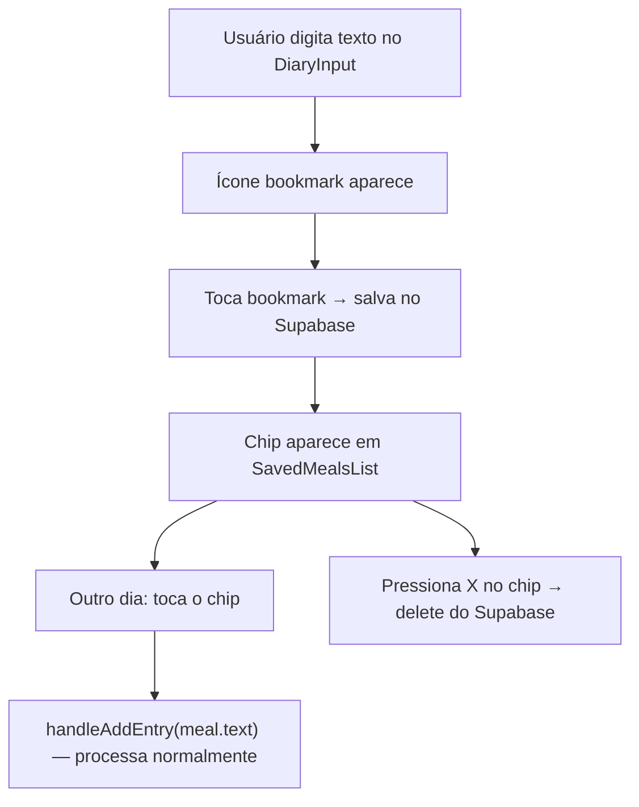

# Quick Saved Meals

## Fluxo completo



## 1. Migration Supabase

Arquivo: `supabase/migrations/20260630120000_saved_meals.sql`

```sql
create table public.saved_meals (
  id uuid primary key default gen_random_uuid(),
  user_id uuid not null references auth.users(id) on delete cascade,
  text text not null,
  created_at timestamptz not null default now()
);
alter table public.saved_meals enable row level security;
create policy "users see own saved meals"
  on public.saved_meals for all
  using (auth.uid() = user_id)
  with check (auth.uid() = user_id);
create index on public.saved_meals (user_id, created_at desc);
```

Aplicar via `supabase db push` ou dashboard (projeto já tem `user-supabase` MCP disponível).

## 2. `src/lib/savedMeals.ts` (novo)

Funções diretas no Supabase client:
- `fetchSavedMeals(userId)` → `select * from saved_meals where user_id = ? order by created_at desc limit 20`
- `createSavedMeal(userId, text)` → `insert`
- `deleteSavedMeal(id)` → `delete by id`

## 3. `src/hooks/useSavedMeals.ts` (novo)

Três hooks com TanStack Query (padrão do projeto):
- `useSavedMeals(userId)` — `useQuery(['saved_meals', userId])`
- `useSaveMeal()` — `useMutation` + invalidate `['saved_meals', userId]`
- `useDeleteSavedMeal()` — `useMutation` + invalidate

## 4. `src/components/SavedMealsList.tsx` (novo)

Componente de chips em scroll horizontal:
- Renderiza apenas quando há refeições salvas (sem estado vazio)
- Cada chip: texto truncado (≤ 30 chars + `…`) + botão `×`
- Props: `meals`, `onSelect(text)`, `onDelete(id)`
- Usa `colors.surface`, `colors.border`, `colors.textSecondary`, `colors.accent`

## 5. `src/components/DiaryInput.tsx` (modificar)

- Nova prop opcional: `onSave?: (text: string) => void`
- Adicionar ícone `Bookmark` (lucide) visível quando `isTyping && !isAnalyzing && !isListening`
- Toque no bookmark chama `onSave(value)` sem limpar o input

Linha de botões atual: `[Camera] [Mic]` → nova ordem: `[Camera] [Mic] [Bookmark]`

## 6. `src/pages/DiaryPage.tsx` (modificar)

- Importar os três hooks e `SavedMealsList`
- Passar `onSave={handleSaveMeal}` para `<DiaryInput>`
- Renderizar `<SavedMealsList>` logo acima do `<DiaryInput>`, dentro da área scrollável existente
- `handleSaveMeal(text)` chama `saveMealMutation.mutate({ userId, text })`
- `onSelect` de `SavedMealsList` chama `handleAddEntry(text)` diretamente

## Truncamento automático do nome

```ts
export function mealLabel(text: string, max = 30): string {
  return text.length > max ? text.slice(0, max).trimEnd() + '…' : text;
}
```

Definido em `savedMeals.ts`, usado em `SavedMealsList.tsx`.

## Arquivos alterados/criados

- `supabase/migrations/20260630120000_saved_meals.sql` — nova tabela
- `src/lib/savedMeals.ts` — CRUD Supabase
- `src/hooks/useSavedMeals.ts` — hooks React Query
- `src/components/SavedMealsList.tsx` — UI de chips
- `src/components/DiaryInput.tsx` — adicionar prop `onSave` + ícone Bookmark
- `src/pages/DiaryPage.tsx` — integrar hooks + componente
