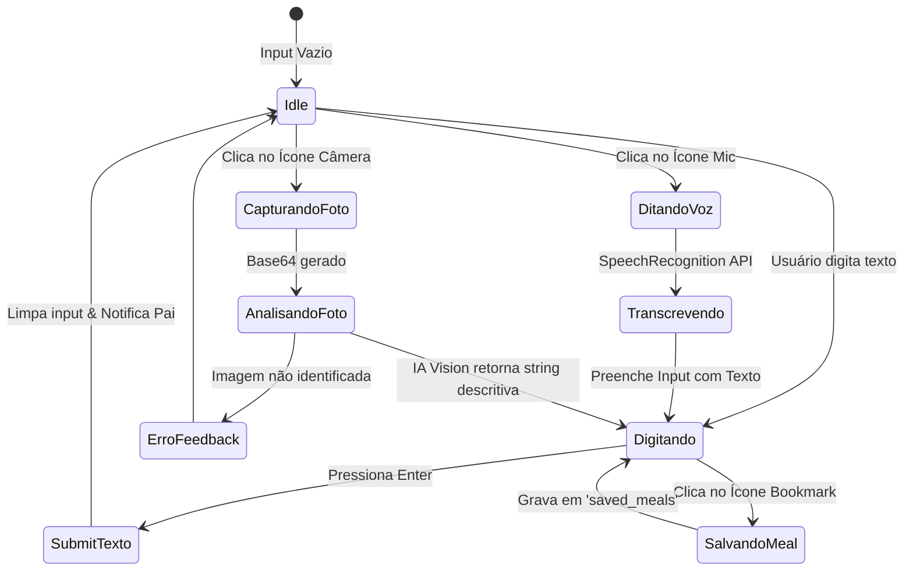
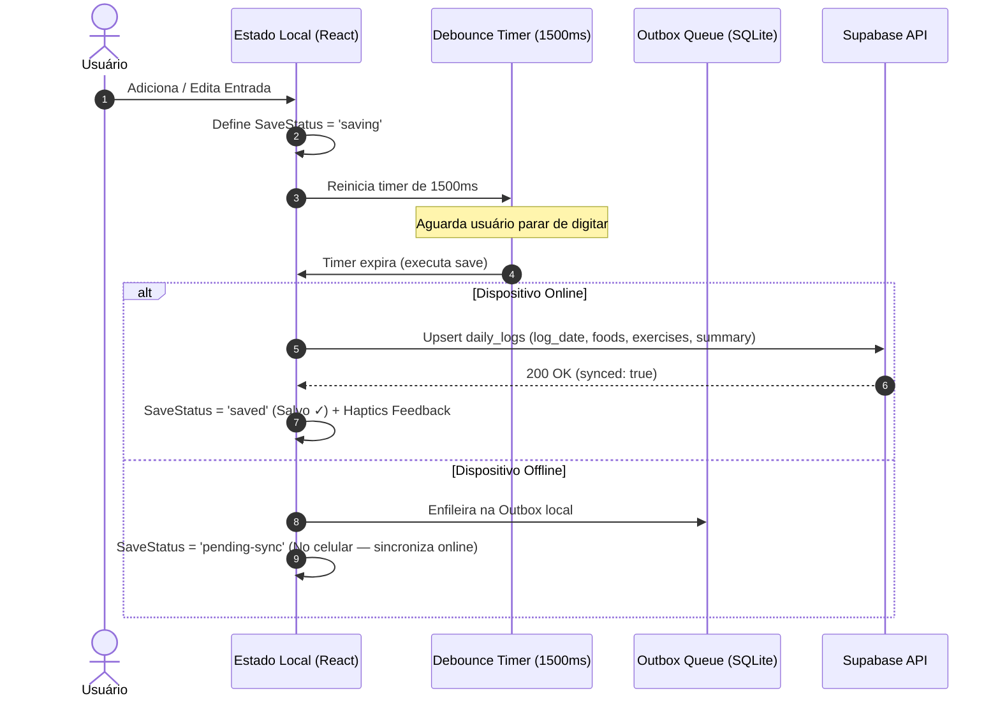

# Módulo Diário Inteligente (Natural Language Journal)

> [!abstract] Visão Geral
> O **Módulo Diário Inteligente** é um sistema de registro diário de refeições e atividades físicas baseado em **linguagem natural contínua (estilo bloco de notas/Amy Food Journal)**. O usuário insere frases livres (ex.: *"2 ovos mexidos com torradas e café"* ou *"45 min musculação"*), que são decompostas, calculadas e enriquecidas assincronamente por IA/Edge Functions, mantendo total suporte **offline-first**, persistência resiliente com fila de sincronização (Outbox pattern) e cálculos dinâmicos de macronutrientes e calorias líquidas.

---

## 1. Diagrama de Arquitetura do Sistema

```mermaid
flowchart TD
    subgraph UI_Layer ["Camada de Apresentação (UI / UX)"]
        Calendar["CalendarStrip (Navegação Temporal)"]
        DiaryInput["DiaryInput (Texto / Voz / Foto)"]
        DiaryList["DiaryList (Itens Reativos & Edição Inline)"]
        SavedMeals["SavedMealsList (Quick-Add)"]
        TotalsBar["DiaryTotalsBar (Pill Flutuante: Kcal + Macros)"]
        SaveBadge["SaveStatus Indicator (idle | saving | saved | pending-sync)"]
    end

    subgraph State_Sync ["Orquestração de Estado & Sincronização"]
        LocalState["State: DiaryEntry[] (Optimistic UI)"]
        DebounceSave["Debounced Auto-Save (1500ms)"]
        ProcessorHook["useDiaryProcessor (Fila de Resolução Assíncrona)"]
    end

    subgraph Offline_Storage ["Armazenamento Local & Offline-First"]
        OutboxQueue["Outbox Queue (SQLite / LocalStorage)"]
        LocalDB["Local Cache (Daily Logs)"]
    end

    subgraph Backend_Cloud ["Backend / Edge AI Services"]
        EdgeSummary["Edge Function: nutrition-summary (NLP + Ranks)"]
        EdgeVision["Edge Function: decipher-food-image (Multimodal AI)"]
        RemoteDB[("Supabase / Postgres: daily_logs")]
    end

    Calendar -->|Seleciona Data| LocalState
    DiaryInput -->|Submit Texto / Transcrição| LocalState
    DiaryInput -->|Captura Foto| EdgeVision
    EdgeVision -->|Retorna Descrição NLP| DiaryInput
    SavedMeals -->|Insere Template| LocalState

    LocalState --> ProcessorHook
    ProcessorHook -->|Calculando... (Status)| DiaryList
    ProcessorHook -->|Chama NLP Parser| EdgeSummary
    EdgeSummary -->|Retorna Macros/Kcal/Tipo| ProcessorHook
    ProcessorHook -->|Atualiza Entradas com 'resolved'| LocalState

    LocalState --> TotalsBar
    LocalState --> DebounceSave
    DebounceSave -->|Dispara Salvar| SaveBadge
    DebounceSave --> LocalDB
    DebounceSave -->|Online| RemoteDB
    DebounceSave -->|Offline| OutboxQueue
    OutboxQueue -->|On Network Reconnect| RemoteDB
```

---

## 2. Modelagem de Dados & Tipagem Genérica (Contracts)

### 2.1. Entidade de Domínio: `DiaryEntry`

Representa uma linha individual na tela do diário.

```typescript
export type DiaryEntryType = 'food' | 'exercise';
export type DiaryEntryStatus = 'idle' | 'calculating' | 'resolved' | 'error';

export interface DiaryEntry {
  id: string;                      // UUIDv4 único gerado no cliente
  rawText: string;                 // Texto livre inserido pelo usuário
  type?: DiaryEntryType;           // Inferido pelo backend ('food' | 'exercise')
  status: DiaryEntryStatus;        // Controle de ciclo de vida da linha
  kcal?: number;                   // Calorias (Positivo para comida, gasto para exercício)
  protein?: number;                // Proteínas em gramas (g)
  carbs?: number;                  // Carboidratos em gramas (g)
  fat?: number;                    // Gorduras totais em gramas (g)
  isNew?: boolean;                 // Flag visual para destacar novos cálculos
  createdAt: string;               // ISO 8601 Timestamp
}
```

### 2.2. Entidade de Resumo Diário: `NutritionSummary`

Consolidação matemática em tempo real da lista de `DiaryEntry`.

```typescript
export interface NutritionSummary {
  consumidas: number;              // Somatório de Kcal de todos os alimentos
  gastas: number;                  // Somatório de Kcal de todos os exercícios
  proteina: number;                // Total de Proteínas (g)
  carboidratos: number;            // Total de Carboidratos (g)
  gordura: number;                 // Total de Gorduras (g)
  duracao: number;                 // Contagem/Duração de exercícios
  alimentos: string[];             // Array de textos de alimentos
  exercicios: string[];            // Array de textos de exercícios
}
```

### 2.3. Entidades de Persistência & Banco de Dados

```typescript
export interface FoodEntry {
  name: string;
  quantity: number;
  localKey?: string;
  per100g?: {
    calorias: number;
    proteina: number;
    carboidratos: number;
    gordura: number;
  };
}

export interface ExerciseEntry {
  name: string;
  durationMinutes: number;
  localKey?: string;
  caloriasPorMinuto: number;
}

export interface DailyLogPersistenceSchema {
  user_id: string;
  log_date: string;                // Formato ISO YYYY-MM-DD
  foods: FoodEntry[];
  exercises: ExerciseEntry[];
  summary: NutritionSummary | null;
  created_at?: string;
  updated_at?: string;
}
```

---

## 3. Especificação das Features e Máquinas de Estado

### 3.1. Entrada de Dados Multimodal (`DiaryInput`)

O componente de entrada unifica **3 modos de inserção**:



#### Regras de Comportamento dos Botões de Ação:
1. **Estado Neutro (sem texto):**
   - Exibe botão de **Câmera** (`Camera` icon).
   - Exibe botão de **Microfone** (`Mic` icon) com animação pulsante quando ativo.
2. **Estado com Texto:**
   - Oculta Câmera e Microfone.
   - Exibe botão de **Bookmark** (`Bookmark` icon) para permitir salvar a frase como refeição reutilizável (Quick Meal).
3. **Skeleton Loading:**
   - Durante a digitação ou análise da foto, exibe o componente `SkeletonText` ("Calculando...") no canto direito do input.

---

### 3.2. Fila de Processamento Reativo (`useDiaryProcessor`)

Evita reprocessamentos desnecessários e chamadas duplicadas à API via lock por `Set<string>`.

> [!important] Lógica de Execução
> 1. Observa a lista `entries` via `useEffect`.
> 2. Filtra itens com status `calculating` cujo `id` não esteja no `processingIds.current`.
> 3. Envia o `rawText` para o endpoint NLP (`nutrition-summary`).
> 4. Classifica como `exercise` se `gastas > 0 && consumidas === 0`, caso contrário `food`.
> 5. Atualiza o estado da entrada com `status: 'resolved'`, valores de Kcal e macronutrientes arredondados.
> 6. Trata falhas com fallback gracioso (`status: 'resolved'`, `kcal: 0`).

---

### 3.3. Edição Inline & Remoção Dinâmica (`DiaryLine`)

- **Modo Leitura:**
  - Lado esquerdo: `rawText` (clicável para entrar em modo de edição).
  - Lado direito: Calorias formatadas (`+105 cal` em destaque para comida, `-300 cal` em verde para exercício) ou `SkeletonText` se estiver calculando.
- **Modo Edição (Ao clicar na linha):**
  - O texto vira um `<input>` inline autofocado.
  - O lado direito substitui as calorias por um botão `X` de exclusão direta.
  - Ao confirmar com `Enter` ou `onBlur`: se o texto mudou, reverte o status para `calculating` e dispara novo cálculo de NLP.
  - Ao pressionar `Escape`: cancela e restaura o texto anterior.

---

### 3.4. Barra de Totais Flutuante (`DiaryTotalsBar`)

Elemento visual fixo suspenso sobre a navegação inferior.

- **Fórmula de Calorias Líquidas:**
  $$\text{Total Kcal} = \sum \text{Kcal}_{\text{consumidas}} - \sum \text{Kcal}_{\text{gastas}}$$
- **Indicadores exibidos:**
  1. 🔥 **Kcal:** Calorias líquidas totais.
  2. 🌾 **Carboidratos:** Gramas totais consumidas.
  3. 🥩 **Proteínas:** Gramas totais consumidas.
  4. 💧 **Gorduras:** Gramas totais consumidas.
- **Comportamento de visibilidade:** O componente só é renderizado se houver ao menos 1 caloria ou macronutriente contabilizado no dia (`hasTotals = true`).

---

### 3.5. Sistema de Auto-Save Debounced e Indicador de Sincronização

Garante fluidez sem travar a digitação do usuário e previne excesso de requisições de escrita.



---

### 3.6. Cálculo de Ofensiva Diária (Streak Algorithm)

Calcula dias consecutivos com registros válidos (`summary != null`):

```typescript
export function computeStreak(historyRows: { log_date: string; summary: any }[]): number {
  if (!historyRows || historyRows.length === 0) return 0;

  const validDates = new Set(
    historyRows
      .filter((r) => r.summary !== null && r.summary !== undefined)
      .map((r) => r.log_date)
  );

  let streak = 0;
  const cursor = new Date();
  
  // Normaliza para meia-noite local
  cursor.setHours(0, 0, 0, 0);

  // Verifica hoje ou ontem como ponto de partida
  const todayStr = formatYYYYMMDD(cursor);
  if (!validDates.has(todayStr)) {
    cursor.setDate(cursor.getDate() - 1);
    const yesterdayStr = formatYYYYMMDD(cursor);
    if (!validDates.has(yesterdayStr)) {
      return 0; // Sequência quebrada
    }
  }

  // Itera regressivamente
  while (validDates.has(formatYYYYMMDD(cursor))) {
    streak++;
    cursor.setDate(cursor.getDate() - 1);
  }

  return streak;
}
```

---

## 4. Guia de Reprodução em Qualquer Stack (Implementation Blueprint)

Para reproduzir este módulo em Flutter, React Native, Vue, Swift/SwiftUI, Kotlin/Jetpack Compose ou Web:

### Passo 1: Parser NLP / Edge Intelligence
Implemente uma API ou serviço local que aceite uma string bruta e devolva a classificação nutricional estruturada:
- **Input:** `{ rawText: "3 fatias de pizza de calabresa e 1 coca zero" }`
- **Output:** `{ type: "food", consumidas: 850, gastas: 0, proteina: 32, carboidratos: 98, gordura: 36 }`

### Passo 2: Gerenciamento de Estado Reativo
- Crie um array de itens com status individual (`calculating`, `resolved`).
- Utilize **Optimistic UI**: a linha aparece instantaneamente na lista com o texto digitado enquanto o status `calculating` exibe o shimmer.

### Passo 3: Debounced Persistence
- Nunca salve a cada tecla. Agrupe as mutações com `debounce` de **1000ms a 1500ms**.
- Salve automaticamente ao desmontar o componente (`cleanup` do ciclo de vida).

### Passo 4: Resiliência Offline-First
- Grave o estado localmente em banco embarcado (SQLite, Room, CoreData, WatermelonDB).
- Caso o network falhe, marque a linha na tabela `sync_outbox` e processe o sync quando o evento `online` disparar.

---

> [!tip] Extensões Recomendadas para Obsidian
> - **Dataview:** Para consultar diários históricos salvos em formato Markdown.
> - **Mermaid:** Para renderização nativa dos fluxos de arquitetura e estados acima.
> - **Obsidian Bases:** Para visualização tabular de registros alimentares.
